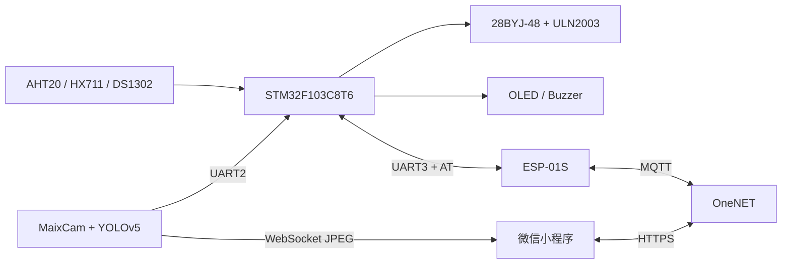

# SmartPetFeeder


基于 STM32F103、MaixCam、OneNET 和微信小程序的物联网视觉识别宠物喂食器。

项目能够完成定时定量出粮、远程手动喂食、温湿度与余粮监测、猫狗识别、进食状态判断、进食时长与消耗重量记录，并在微信小程序中展示设备数据和摄像头画面。

> 当前版本是教学与原型验证项目，不建议未经安全评估直接用于无人值守、长期运行或商业产品。

## 系统组成



## 主要功能

- 每秒读取时钟和余粮重量，检查最多 5 组定时喂食计划。
- 每 5 秒读取温湿度并向 OneNET 上报设备数据。
- 通过小程序下发手动出粮和定时计划。
- MaixCam 使用 YOLOv5 识别猫狗，并根据检测框比例判断进食状态。
- STM32 根据进食开始和结束时的重量差计算消耗量。
- MaixCam 通过 WebSocket 向小程序发送低码率 JPEG 画面。

## 仓库结构

```text
firmware/stm32f103/   STM32CubeMX 和 Keil MDK 工程
vision/maixcam/       MaixCam 视觉识别与视频流程序
miniapp/wechat/       微信小程序
hardware/             BOM 与硬件资料入口
docs/                 架构、接线、协议和部署文档
tutorials/            面向初学者的分章节复现教程
assets/               README 与演示素材
```

## 从零复现教程

如果你第一次接触完整嵌入式项目，建议从教程目录开始，而不是直接阅读最终版源码：

- [零基础入门路线：从认识模块开始](tutorials/beginner/README.md)
- [教程总目录](tutorials/README.md)
- [第 0 章：项目介绍与系统架构](tutorials/00-项目介绍.md)
- [第 1 章：硬件准备与接线](tutorials/01-硬件准备与接线.md)
- [第 2 章：STM32 工程与首次运行](tutorials/02-STM32工程与首次运行.md)
- [第 3 章：HX711 称重与标定](tutorials/03-HX711称重与标定.md)
- [第 4 章：步进电机与出粮标定](tutorials/04-步进电机与出粮标定.md)
- [第 5 章：显示、传感器与实时时钟](tutorials/05-显示传感器与实时时钟.md)
- [第 6 章：ESP-01S 与 OneNET](tutorials/06-ESP01S与OneNET.md)
- [第 7 章：MaixCam 视觉识别](tutorials/07-MaixCam视觉识别.md)
- [第 8 章：微信小程序](tutorials/08-微信小程序.md)
- [第 9 章：系统联调](tutorials/09-系统联调.md)
- [第 10 章：测试、排障与改进](tutorials/10-测试排障与改进.md)

后续章节将依次覆盖 STM32 基础、称重标定、电机控制、传感器、OneNET、MaixCam、微信小程序和系统联调。

## 快速开始

1. 阅读 [`docs/hardware.md`](docs/hardware.md)，完成供电和模块接线。
2. 将 `firmware/stm32f103/Core/Inc/app_config.example.h` 复制为 `app_config.h`，填写 Wi-Fi 和 OneNET 参数。
3. 使用 Keil MDK 打开 `firmware/stm32f103/MDK-ARM/F103_Feeder.uvprojx`，编译并烧录。
4. 将 `vision/maixcam/config.example.py` 复制为 `config.py`，配置 Wi-Fi、串口和模型路径，然后部署到 MaixCam。
5. 将 `miniapp/wechat/config.example.js` 复制为 `config.js`，配置 OneNET 鉴权信息和 MaixCam WebSocket 地址。
6. 使用微信开发者工具导入 `miniapp/wechat`。

完整步骤见 [`docs/build-and-deploy.md`](docs/build-and-deploy.md)。

## 文档

- [系统架构](docs/architecture.md)
- [硬件接线](docs/hardware.md)
- [通信协议](docs/protocol.md)
- [构建与部署](docs/build-and-deploy.md)
- [OneNET 配置](docs/onenet.md)
- [问题排查](docs/troubleshooting.md)
- [发布检查清单](docs/release-checklist.md)
- [视觉素材制作计划](docs/visual-content-plan.md)

## 安全提醒

本仓库不包含可用的 Wi-Fi 密码、OneNET Token 或正式小程序 AppID。公开仓库前应吊销所有曾经写入旧仓库历史的凭据，并重新生成。

涉及电机和外部电源时，请确保共地、正确降压并做好堵转保护。不要使用面包板长期承载电机电流。

## 开源许可

项目自行编写的代码和文档采用 [MIT License](LICENSE)。STM32 HAL、CMSIS 等第三方组件仍使用各自许可证，详见 [THIRD_PARTY_NOTICES.md](THIRD_PARTY_NOTICES.md)。
