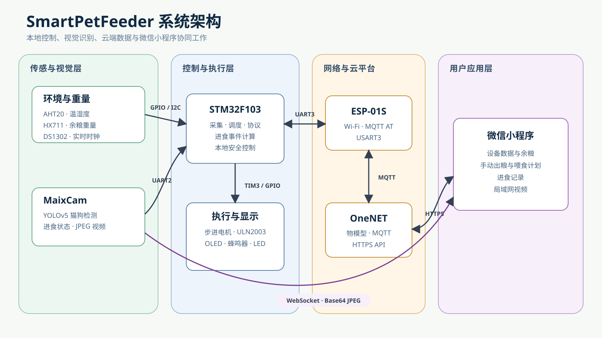
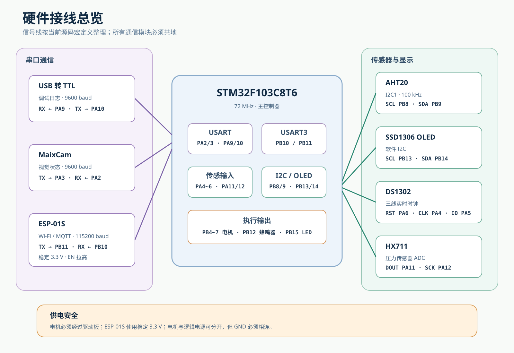
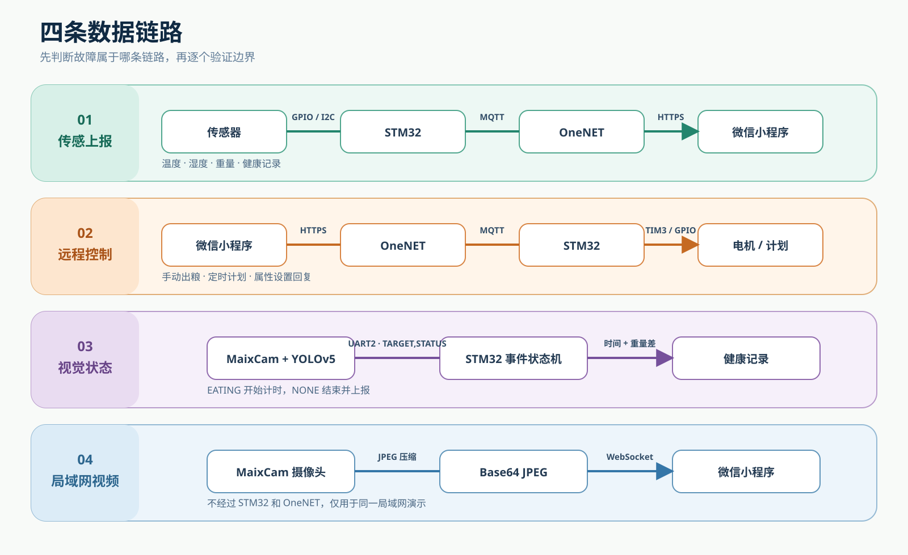
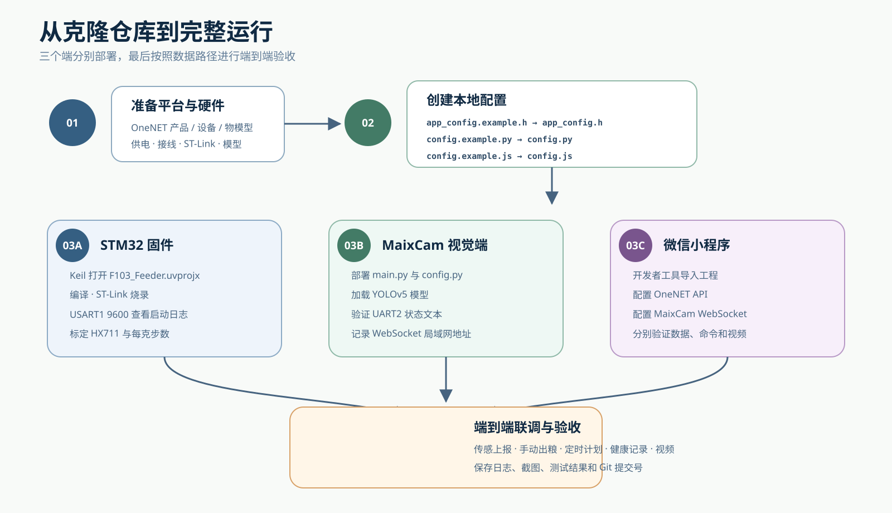

# 视觉素材制作计划

## 目标

本计划用于把现有文字教程升级为适合 GitHub 阅读、课程分享和毕业答辩展示的图文教程。

原则：

- 技术图由仓库直接维护，保证可修改和可追踪
- 实物照片与平台截图必须来自真实设备
- 所有图片先脱敏，再进入公开仓库
- 每张图只表达一个主要问题
- 图片必须配图注，不能依赖图片传达唯一关键信息

## 当前进度

| 类别 | 数量 | 负责人 | 状态 |
| --- | ---: | --- | --- |
| 系统架构图 | 1 | 项目文档 | 已制作 |
| 硬件接线总览 | 1 | 项目文档 | 已制作 |
| 四条数据链路图 | 1 | 项目文档 | 已制作 |
| 部署流程图 | 1 | 项目文档 | 已制作 |
| 实物照片 | 6 组 | 需要你 | 待提供 |
| 软件截图 | 9 组 | 需要你 | 待提供 |
| 演示视频原始片段 | 5 组 | 需要你 | 待提供 |
| 图片裁剪、标注与图注 | 全部 | 项目文档 | 收到素材后处理 |

## 已制作的技术图

### 系统架构

用于 README 和第 0 章，展示传感器、主控制器、视觉端、云平台和小程序的关系。

### 硬件接线总览

用于第 1 章，集中展示三个串口、传感器、OLED、步进电机和蜂鸣器引脚。

### 四条数据链路

用于网络和联调章节，区分传感上报、远程控制、视觉状态和局域网视频。

### 部署流程

用于构建与联调章节，展示平台准备、三个端分别部署和最终验收的顺序。

## 目录约定

~~~text
assets/
├── diagrams/       可编辑技术图
├── photos/         实物照片
├── screenshots/    软件和日志截图
└── video/          视频脚本、封面与发布说明
~~~

命名使用小写英文和连字符：

~~~text
hardware-overview-front.jpg
hx711-load-cell-mount.jpg
keil-build-success.png
onenet-device-properties.png
maixcam-cat-detection.png
miniapp-home.png
~~~

## 逐章素材安排

| 章节 | 图或截图 | 负责人 | 用途 |
| --- | --- | --- | --- |
| README / 第 0 章 | 系统架构图 | 项目文档 | 一眼理解系统组成 |
| 第 1 章 | 硬件接线总览 | 项目文档 | 核对模块和引脚 |
| 第 1 章 | 完整设备正面照 | 需要你 | 展示最终成品 |
| 第 1 章 | 内部接线全景 | 需要你 | 对照实际布线 |
| 第 2 章 | Keil 编译成功 | 需要你 | 证明工程可构建 |
| 第 2 章 | USART1 启动日志 | 需要你 | 展示初始化顺序 |
| 第 3 章 | 称重传感器安装 | 需要你 | 说明受力结构 |
| 第 3 章 | 标定日志 | 需要你 | 展示零点和原始值 |
| 第 4 章 | 电机与出粮机构 | 需要你 | 说明机械结构 |
| 第 4 章 | 多次出粮测试表 | 项目文档 | 展示标定结果 |
| 第 5 章 | OLED 主界面 | 需要你 | 展示本地反馈 |
| 第 6 章 | 四条数据链路图 | 项目文档 | 区分云端和局域网 |
| 第 6 章 | OneNET 设备属性 | 需要你 | 验证云端上报 |
| 第 7 章 | MaixCam 安装位置 | 需要你 | 说明机位 |
| 第 7 章 | 猫狗检测画面 | 需要你 | 展示识别效果 |
| 第 8 章 | 小程序首页 | 需要你 | 展示数据页面 |
| 第 8 章 | 计划、记录和视频页 | 需要你 | 展示主要交互 |
| 第 9 章 | 部署流程图 | 项目文档 | 指导完整部署 |
| 第 9 章 | 完整联调现场 | 需要你 | 作为验收证据 |
| 第 10 章 | 故障定位流程 | 项目文档 | 指导问题排查 |

## 需要你提供的实物照片

请使用手机原相机拍摄，优先横向 4:3，不要添加滤镜或文字。

### 1. 完整设备

- 正面全景
- 侧面全景
- 打开外壳后的内部全景

### 2. 控制与接线

- STM32、ESP-01S、驱动板同框近照
- 能看清线序，但不要露出 Wi-Fi 标签或个人信息

### 3. 称重结构

- 传感器固定端
- 受力端
- HX711 接线
- 料斗与外壳之间的间隙

### 4. 出粮结构

- 步进电机
- ULN2003
- 叶轮或螺杆
- 出粮口

### 5. MaixCam 机位

- 相机相对食盆的位置
- 相机看到的实际视角

### 6. OLED

- 正常显示时间与余粮百分比
- 避免屏幕过曝

## 需要你提供的软件截图

截图前先隐藏或替换：

- Wi-Fi 名称和密码
- OneNET Token 与 Authorization
- 正式 AppID
- 设备密钥
- 个人账号和通知
- 不希望公开的局域网或公网地址

需要的截图：

1. Keil Build：能看见 0 Error 和 0 Warning
2. USART1：完整启动日志
3. HX711：去皮和标定日志
4. OneNET：设备在线和属性值
5. MaixCam：带检测框和状态标签
6. 小程序：首页
7. 小程序：手动出粮
8. 小程序：喂食计划
9. 小程序：进食记录与视频

## 需要你提供的视频片段

每段保留原声，横屏拍摄，建议 1080p：

1. 设备上电和 OLED 启动，10 秒
2. 小程序点击手动出粮到电机完成，20 秒
3. 定时计划到点自动出粮，20 秒
4. MaixCam 检测到宠物并生成进食记录，30 秒
5. 完整设备稳定运行的全景，15 秒

不需要自行剪辑。收到原始片段后，再统一规划字幕、封面、顺序和讲解。

## 素材验收标准

- 主体清晰，无明显抖动和过曝
- 横竖方向一致
- 不包含真实密钥和个人信息
- 图片能够说明对应章节的问题
- 同一模块至少有一张全景和一张近景
- 截图保留必要的标题、时间和状态

## 下一步

项目文档先完成并嵌入 4 张技术图。你可以同步按本清单拍摄，不必等待全部素材一次完成；每提供一组，就可以处理并加入对应章节。
