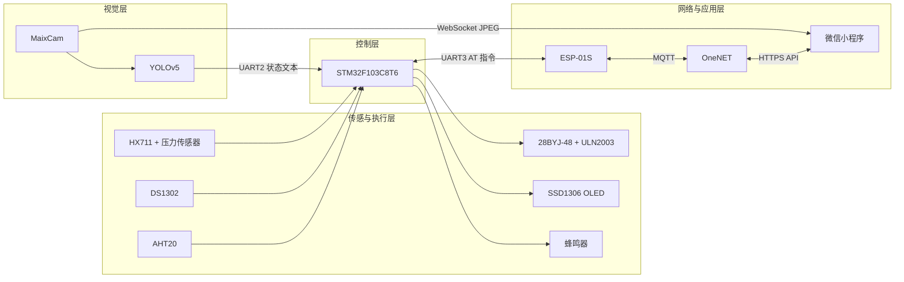
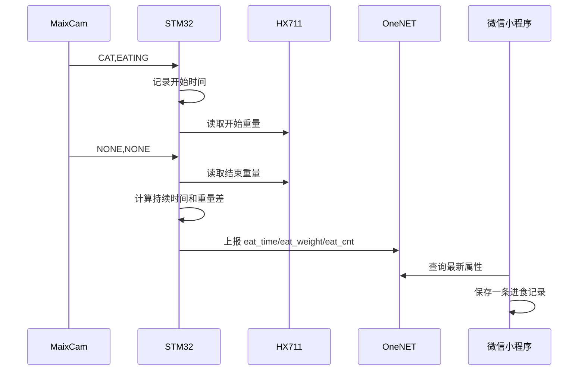

# 第 0 章：项目介绍与系统架构

## 本章目标

完成本章后，你应该能够：

- 说清楚 SmartPetFeeder 要解决什么问题
- 理解 STM32、MaixCam、ESP-01S、OneNET 和微信小程序的职责
- 理解四条主要数据链路
- 知道仓库中每个目录的用途
- 了解当前原型的能力边界

本章不需要接线，也不需要烧录代码。

## 1. 项目要解决什么问题

普通定时喂食器只能在设定时间转动电机，却很难回答三个问题：

1. 粮仓里还剩多少食物？
2. 宠物有没有真正来进食？
3. 宠物每次吃了多久、吃了多少？

SmartPetFeeder 在定时出粮的基础上增加称重、视觉识别和云端交互，使喂食器从单一执行器变成可以采集和展示进食信息的原型系统。

## 2. 功能拆分

| 功能 | 主要模块 | 输出结果 |
| --- | --- | --- |
| 定时出粮 | DS1302、STM32、步进电机 | 到点后按设定重量出粮 |
| 手动加餐 | 微信小程序、OneNET、ESP-01S、STM32 | 手机下发指定克数 |
| 余粮监测 | 压力传感器、HX711、STM32 | 当前重量 |
| 环境监测 | AHT20、STM32 | 温度和湿度 |
| 本地显示 | STM32、SSD1306 OLED | 时间和余粮百分比 |
| 宠物检测 | MaixCam、YOLOv5 | `CAT`、`DOG` 或 `NONE` |
| 进食判断 | MaixCam、STM32、HX711 | 状态、持续时间和消耗重量 |
| 远程展示 | OneNET、微信小程序 | 传感数据、记录和视频画面 |

## 3. 系统总体架构



## 4. 各模块的职责

### STM32F103

STM32 是系统的主控制器，负责：

- 初始化 GPIO、串口、I2C 和定时器
- 读取温湿度、时间和重量
- 刷新 OLED
- 保存并检查喂食计划
- 控制步进电机和蜂鸣器
- 解析 MaixCam 状态
- 通过 ESP-01S 与 OneNET 通信

主循环不运行操作系统，而是根据 `HAL_GetTick()` 执行 1 秒和 5 秒周期任务。

### MaixCam

MaixCam 负责计算量较大的视觉任务：

- 采集摄像头图像
- 运行 YOLOv5 猫狗检测
- 根据检测框比例和位置估计进食状态
- 每秒向 STM32 发送一次状态
- 向小程序发送低帧率 JPEG 视频流

视觉模块只发送简短状态，避免 STM32 处理图像。

### ESP-01S 与 OneNET

ESP-01S 运行 AT 固件，通过 UART3 接收 STM32 指令：

- 连接 2.4 GHz Wi-Fi
- 建立 MQTT 连接
- 上传传感数据
- 订阅属性设置主题
- 把小程序命令传给 STM32

OneNET 是设备和小程序之间的中间平台。

### 微信小程序

小程序负责用户交互：

- 查询 OneNET 最新属性
- 下发手动出粮命令
- 新增、修改和关闭定时计划
- 保存本机喂食记录
- 连接 MaixCam WebSocket 视频流

当前喂食记录保存在微信本地缓存，不是云数据库。

## 5. 四条数据链路

### 传感数据上报

```text
AHT20 / HX711 / DS1302
        ↓
      STM32
        ↓ UART3
     ESP-01S
        ↓ MQTT
      OneNET
        ↓ HTTPS
    微信小程序
```

### 远程控制

```text
微信小程序 → OneNET → ESP-01S → STM32 → ULN2003 → 步进电机
```

### 视觉状态

```text
摄像头 → YOLOv5 → MaixCam → UART2 → STM32
```

MaixCam 发送的基本格式是：

```text
<TARGET>,<STATUS>\r\n
```

例如：

```text
CAT,EATING
DOG,WAITING
NONE,NONE
```

### 视频画面

```text
MaixCam → JPEG → Base64 → WebSocket → 微信小程序
```

视频不经过 OneNET，只适合局域网演示。

## 6. 一次进食事件如何产生



只有持续时间达到程序阈值的事件才会上报，短暂误识别会被忽略。

## 7. 仓库结构

```text
SmartPetFeeder/
├── firmware/stm32f103/   STM32 固件与 Keil 工程
├── vision/maixcam/       MaixCam 视觉程序
├── miniapp/wechat/       微信小程序
├── hardware/             BOM 与硬件资料
├── docs/                 参考文档
├── tutorials/            从零复现教程
├── assets/               原创图片和演示素材
├── README.md              项目首页
└── LICENSE                开源许可证
```

`docs` 更像技术手册，适合快速查参数；`tutorials` 按学习顺序编写，适合第一次复现项目。

## 8. 当前原型的限制

在教程开始前，需要明确当前项目不是成熟产品：

- 喂食计划保存在 STM32 RAM，断电后会丢失
- Wi-Fi 与 MQTT 初始化使用阻塞延时
- 视觉姿态是基于检测框的启发式判断
- 小程序健康记录保存在本机
- WebSocket 视频没有用户认证
- 没有电机电流检测和堵转保护
- 没有完成食品接触材料和长期可靠性验证

这些限制不是需要隐藏的缺点，而是后续学习和改进的入口。

## 9. 推荐学习顺序

不要一开始就连接所有模块。推荐顺序：

1. STM32 最小系统和串口日志
2. HX711 单模块称重
3. ULN2003 和步进电机
4. OLED、AHT20、DS1302
5. ESP-01S 和 OneNET
6. MaixCam UART 状态
7. 微信小程序
8. 完整联调

每增加一个模块，都先完成独立验证，再接入主工程。

## 10. 本章检查清单

- [ ] 能解释 STM32 和 MaixCam 为什么分工处理
- [ ] 能画出传感数据上报路径
- [ ] 能画出远程控制路径
- [ ] 知道视频流不经过 OneNET
- [ ] 知道当前项目是教学原型，不是商业产品
- [ ] 找到固件、视觉端和小程序源码目录

下一章：[第 1 章：硬件准备与接线](01-硬件准备与接线.md)
