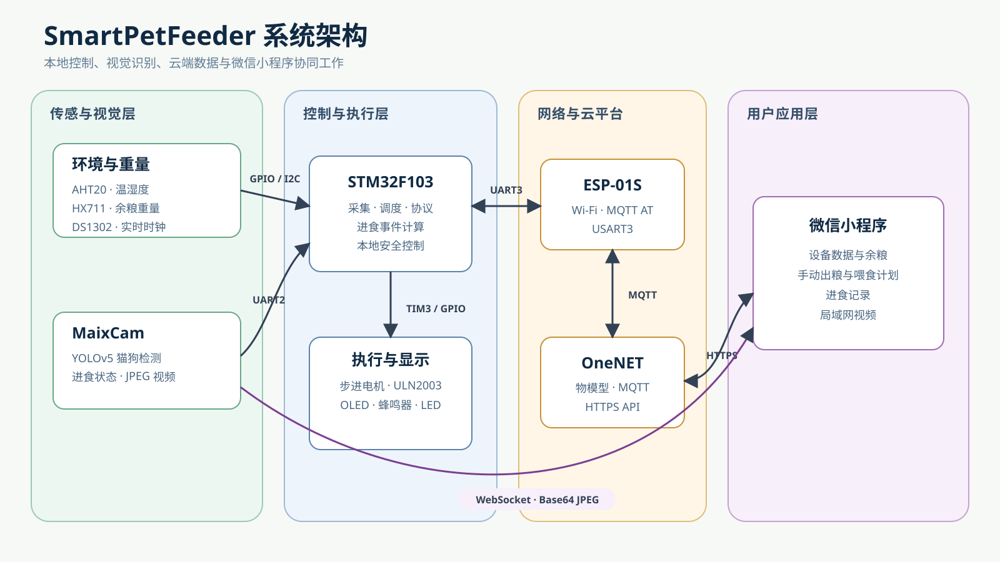

# 第 1 课：认识项目和硬件

## 这一课要完成什么

这一课不通电，也不接线。

你只需要把模块摆在桌上，知道它们叫什么、分别负责什么。

## 先看完整系统

看不懂图中的英文没有关系。

先记住一件事：这个项目不是由一块板子完成的，而是由多块板子合作完成。

## STM32：设备的大脑

项目使用 STM32F103C8T6 开发板。

它负责：

- 读取传感器
- 查看当前时间
- 计算剩余粮食重量
- 控制电机
- 刷新 OLED 屏幕
- 接收摄像头和云平台的数据

你可以把 STM32 理解成喂食器的大脑。

## 传感器：设备的感觉

### AHT20

作用：测量温度和湿度。

它告诉 STM32 当前环境是热、冷、干燥还是潮湿。

### HX711 和压力传感器

作用：测量重量。

压力传感器感受到料桶重量，HX711 把这个很小的信号变成 STM32 能够读取的数字。

### DS1302

作用：保存时间。

即使主电源关闭，只要后备电池正常，它仍可以继续计时。

## 电机：设备的手

项目使用 28BYJ-48 步进电机。

电机负责带动出粮机构。

STM32 不能直接推动电机，所以中间需要 ULN2003 驱动板。

可以这样理解：

~~~text
STM32 发出命令
      ↓
ULN2003 提供驱动能力
      ↓
步进电机转动
~~~

## OLED：设备的小屏幕

OLED 用来显示：

- 当前时间
- 剩余粮食百分比

它不负责计算，只负责把 STM32 给它的内容显示出来。

## ESP-01S：设备的网络助手

STM32 本身不能直接连接 Wi-Fi。

ESP-01S 帮助 STM32：

- 连接 2.4 GHz Wi-Fi
- 把数据发送到 OneNET
- 接收小程序发来的命令

## OneNET：网络中转站

OneNET 是云平台。

它位于智能喂食器和微信小程序之间：

~~~text
智能喂食器 → OneNET → 微信小程序
微信小程序 → OneNET → 智能喂食器
~~~

## MaixCam：设备的眼睛

MaixCam 是带摄像头的开发板。

它负责：

- 拍摄画面
- 使用模型检测猫或狗
- 判断目标可能正在进食、休息或等待
- 把状态发送给 STM32
- 把画面发送给微信小程序

## 微信小程序：设备的遥控器

小程序可以：

- 查看温度和湿度
- 查看剩余粮食
- 手动出粮
- 设置喂食时间
- 查看进食记录
- 查看摄像头画面

## 你要做

把你手上的模块放在桌面上。

按照下面的清单逐个找到：

- [ ] STM32F103C8T6
- [ ] ST-Link
- [ ] USB 转 TTL 串口模块
- [ ] OLED
- [ ] AHT20
- [ ] DS1302
- [ ] HX711
- [ ] 压力传感器
- [ ] 28BYJ-48 步进电机
- [ ] ULN2003 驱动板
- [ ] ESP-01S
- [ ] MaixCam
- [ ] 蜂鸣器
- [ ] 电源和连接线

如果模块丝印和教程不一样，先拍清楚正面和背面，不要直接通电。

## 正确现象

完成这一课后，你应该能够拿起一个模块，说出：

- 它叫什么
- 它负责什么
- 它是传感器、控制器还是执行器

暂时不需要知道每个引脚怎么接。

## 容易混淆的地方

### STM32 和 ESP-01S 有什么区别

STM32 负责控制整个设备。

ESP-01S 主要负责联网。

### STM32 和 MaixCam 有什么区别

STM32 适合控制传感器和电机。

MaixCam 适合处理摄像头画面和目标检测。

### HX711 是压力传感器吗

不是。

压力传感器负责感受重量，HX711 负责读取压力传感器的微弱信号。

## 这一课的完成标准

- [ ] 能指出 STM32
- [ ] 能指出电机和驱动板
- [ ] 能区分 HX711 和压力传感器
- [ ] 知道 ESP-01S 负责联网
- [ ] 知道 MaixCam 负责视觉识别
- [ ] 还没有给不确定的模块通电

上一课：[怎么使用这套教程](00-怎么使用这套教程.md)

下一课：[电源、GND 和安全接线](02-电源GND和安全接线.md)

返回：[零基础教程目录](README.md)
