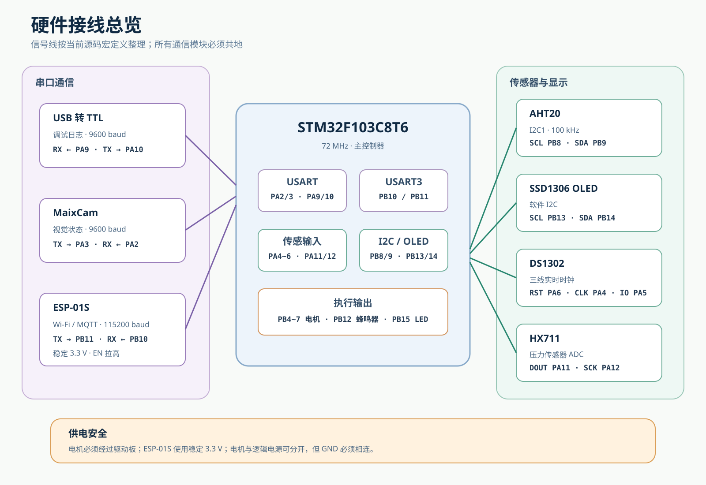

# 第 2 课：电源、GND 和安全接线

## 这一课要完成什么

这一课学习三个最重要的接线概念：

- 电压不能乱接
- 通信模块必须连接 GND
- 电机必须经过驱动板

这一课仍然不要求你把完整系统接起来。

## 什么是电压

可以暂时把电压理解成电的“推动力量”。

这个项目会遇到两种常见电压：

- 3.3 V
- 5 V

它们不能随便互换。

例如：

- STM32 的信号通常是 3.3 V
- ESP-01S 需要稳定的 3.3 V
- 本项目的 28BYJ-48 电机是 5 V 版本

模块电压接错，可能导致：

- 模块不工作
- 数据错误
- 芯片发热
- 模块永久损坏

## 注意

看到模块上的 <code>VCC</code>，不要马上接 5 V。

先查看：

1. 模块型号
2. 模块正反面的丝印
3. 商家或厂家给出的供电说明

无法确认时，先拍照记录，不要通电。

## 什么是 GND

GND 常被叫作“地”。

两个模块要互相发送电信号时，需要一个共同的参考点。这个参考点通常就是 GND。

可以简单记成：

> 两块板子要说话，通常要先把 GND 连在一起。

例如 STM32 和 MaixCam 使用串口通信时：

~~~text
STM32 GND ─── MaixCam GND
~~~

如果没有共地，可能出现：

- 完全收不到数据
- 偶尔收到乱码
- 设备时好时坏

## TX 和 RX 是什么

串口使用 TX 和 RX 发送文字数据。

- TX：发送
- RX：接收

接线时通常要交叉：

~~~text
设备 A TX → 设备 B RX
设备 A RX ← 设备 B TX
设备 A GND ─ 设备 B GND
~~~

可以把它理解成：

- 一个人的嘴，对着另一个人的耳朵
- TX 是嘴
- RX 是耳朵

TX 接 TX，就像两个人都在说话，没有人在听。

## 为什么电机不能直接接 STM32

STM32 引脚只能提供很小的控制信号。

电机需要更大的电流。

因此必须使用 ULN2003 驱动板：

~~~text
STM32
  ↓ 小的控制信号
ULN2003
  ↓ 驱动电流
步进电机
~~~

不要把步进电机线圈直接连接 STM32 引脚。

## 为什么电机容易让系统重启

电机启动时会突然需要较大电流。

如果电机、STM32 和 ESP-01S 共用一个能力不足的电源，电压可能突然降低。

结果可能是：

- STM32 重启
- ESP-01S 掉线
- OLED 花屏
- HX711 重量跳动

所以后面会让电机和逻辑电路分阶段接入。

## 学会看接线表

接线表通常长这样：

| 模块引脚 | STM32 引脚 |
| --- | --- |
| TX | PA3 |
| RX | PA2 |
| GND | GND |

第一行表示：模块 TX 连接 STM32 PA3。

第二行表示：模块 RX 连接 STM32 PA2。

不要根据杜邦线颜色猜功能。线的颜色可以帮助整理，但颜色本身没有固定含义。

## 完整接线图先不用背

现在只需要知道这张图以后可以用来检查引脚。

不用在这一课把所有线路接完。

## 你要做：找到三个标记

拿出 STM32、ESP-01S 和 ULN2003。

在板子上找到：

- [ ] VCC 或 3.3 V / 5 V
- [ ] GND
- [ ] TX 和 RX，或者 IN1 到 IN4

把模块正反面拍下来。

照片要能够看清丝印。暂时不要通电。

## 你要做：学习测量电压

如果你有万用表，可以先练习测量 USB 供电模块。

1. 将万用表转到直流电压档。
2. 黑表笔连接 GND。
3. 红表笔接触要测量的电源点。
4. 读取屏幕数值。
5. 测量时不要让两个表笔碰在一起。

如果从未使用过万用表，请让老师、实验室同学或有经验的人现场演示一次。

## 正确现象

完成这一课后，你应该能够解释：

- 为什么 3.3 V 和 5 V 不能随便互换
- 为什么通信模块需要共地
- 为什么 TX 要连接对方的 RX
- 为什么电机需要驱动板

## 如果模块发热怎么办

立即断电。

不要继续尝试，也不要用手长时间触摸芯片。

检查：

1. 电源正负是否接反
2. 电压是否正确
3. VCC 和 GND 是否短路
4. 模块型号是否与教程一致

## 这一课的完成标准

- [ ] 知道不确认电压时不能通电
- [ ] 能在模块上找到 GND
- [ ] 知道 TX 和 RX 通常交叉连接
- [ ] 知道通信模块需要共地
- [ ] 知道电机必须使用驱动板
- [ ] 知道模块发热时应立即断电

上一课：[认识项目和硬件](01-认识项目和硬件.md)

下一课：[安装软件并打开工程](03-安装软件并打开工程.md)

返回：[零基础教程目录](README.md)
